# 🗺️ Data Engineering Master Learning Roadmap (2026 Baseline)

This document outlines the complete architectural progression of the curriculum, from core CS and Unix/macOS systems fundamentals to production-grade distributed streaming, cloud infrastructure, and enterprise data platforms.

---

## 🏗️ Visual Curriculum Progression

```mermaid
flowchart TD
    subgraph P1["Phase 1: Systems & Programming Foundations"]
        direction TB
        LNX["macOS & POSIX Streams<br/>(LNX-01 - LNX-06)"]
        GIT["Git Internals & Trunk Flow<br/>(GIT-01 - GIT-04)"]
        PY["Production Python 3.12+ & uv<br/>(PY-01 - PY-14)"]
        SQL["Analytical SQL & Query Execution<br/>(SQL-01 - SQL-14)"]
        LNX --> GIT --> PY --> SQL
    end

    subgraph P2["Phase 2: Storage, Modeling & Modern ELT"]
        direction TB
        DB["Storage Internals (WAL/MVCC/Pages)<br/>(DB-01 - DB-06)"]
        MOD["Kimball Star Schema & Medallion<br/>(MOD-01 - MOD-08)"]
        DBT["dbt-core & DuckDB In-Warehouse ELT<br/>(DBT-01 - DBT-10)"]
        DW["Cloud Data Warehouses (Snowflake/BQ)<br/>(DW-01 - DW-06)"]
        PRJ1["Project 1: Local Modern ELT Pipeline"]
        DB --> MOD --> DBT --> DW --> PRJ1
    end

    subgraph P3["Phase 3: Scale, Distributed Compute & Streaming"]
        direction TB
        LAK["Open Table Formats & Apache Iceberg<br/>(LAK-01 - LAK-08)"]
        SPK["Apache Spark 4.0 & Catalyst Optimizer<br/>(SPK-01 - SPK-12)"]
        PRJ2["Project 2: Scalable Lakehouse (Spark + Iceberg)"]
        AIR["Apache Airflow 3.x Asset Scheduling<br/>(AIR-01 - AIR-09)"]
        KFK["Apache Kafka 4.0 KRaft Streaming<br/>(KFK-01 - KFK-09)"]
        PRJ3["Project 3: Real-Time Fleet Streaming"]
        LAK --> SPK --> PRJ2 --> AIR --> KFK --> PRJ3
    end

    subgraph P4["Phase 4: Cloud, DevOps & Reliability Engineering"]
        direction TB
        CLD["AWS Architecture (IAM, S3, Glue, Athena)<br/>(CLD-01 - CLD-06)"]
        OPS["Docker & Declarative Terraform IaC<br/>(OPS-01 - OPS-08)"]
        DAT["Soda Core & OpenLineage Observability<br/>(DAT-01 - DAT-06)"]
        GOV["Access Control & PII Masking<br/>(GOV-01 - GOV-05)"]
        PRJ4["Project 4: Production Cloud Platform"]
        CERT1["Certification: AWS Certified Data Engineer (DEA-C01)"]
        CLD --> OPS --> DAT --> GOV --> PRJ4 --> CERT1
    end

    subgraph P5["Phase 5: System Design, Capstones & Career Launch"]
        direction TB
        DES["High-Throughput Distributed System Design<br/>(DES-01 - DES-06)"]
        PRJ5["Project 5: Converged Enterprise Lakehouse"]
        INT["50 SQL Drills & Live Coding Preparation<br/>(INT-01 - INT-06)"]
        JOB["Job-Ready Checklist Verification"]
        DES --> PRJ5 --> INT --> JOB
    end

    P1 -->|Milestone Gate 1| P2
    P2 -->|Milestone Gate 2| P3
    P3 -->|Milestone Gate 3| P4
    P4 -->|Milestone Gate 4| P5
```

---

## 🎯 Strategic Ordering Adjustments & 2026 Rationale

1. **Modern ELT (dbt + DuckDB) Precedes Distributed Spark**:
   Single-node processing (DuckDB, Polars) handles sub-terabyte workloads with 90% less infrastructure overhead. Students master analytical modeling and SQL transformations locally before tackling distributed cluster shuffles and network overhead.
2. **Open Table Formats (Iceberg) Introduced Before Spark Deep Dive**:
   Understanding table metadata (manifests, snapshots, ACID guarantees on object storage) makes Spark partition tuning and write modes intuitive.
3. **Kafka KRaft Exclusivity**:
   Apache Kafka 4.0 completely removed ZooKeeper. Ingestion architectures are taught purely under KRaft metadata consensus.
4. **Airflow 3.x Asset-Centric Scheduling**:
   Shifted away from deprecated cron intervals and `execution_date` parameters to event-driven `@asset` data dependencies and the TaskFlow API.
5. **Decoupled Infrastructure via Docker & LocalStack**:
   Cloud concepts are practiced locally first (MinIO for S3, LocalStack for AWS APIs) to ensure zero accidental cloud billing for independent students.

---

## 📊 Phase Summary Matrix

| Phase | Purpose | Prerequisites | Target Skills | Duration |
| :--- | :--- | :--- | :--- | :--- |
| **[[Phase 1 - Foundations\|Phase 1]]** | Master the terminal, write production-grade typed Python, and write high-performance analytical SQL. | Basic programming literacy | macOS Terminal, POSIX CLI, Bash scripting, Git rebasing, Python 3.12+, Pydantic v2, Polars, Pytest, SQL Window Functions, Execution Plans | Months 1–3 (12 Weeks) |
| **[[Phase 2 - Storage & ELT\|Phase 2]]** | Design resilient data schemas and build automated local warehouse transformation pipelines. | Phase 1 completion | Relational internals, Kimball Star Schema, SCD Type 2, Medallion tiers, dbt-core, DuckDB, Snowflake architecture | Months 4–5 (8 Weeks) |
| **[[Phase 3 - Scale & Streaming\|Phase 3]]** | Process large datasets across distributed clusters and build event-driven stream pipelines. | Phase 2 completion | Parquet internals, Apache Iceberg, PySpark 4.0, Catalyst tuning, Airflow 3.x `@asset` scheduling, Kafka 4.0 KRaft | Months 6–8 (12 Weeks) |
| **[[Phase 4 - Cloud & DevOps\|Phase 4]]** | Provision cloud infrastructure as code, containerize environments, and enforce data quality gating. | Phase 3 completion | AWS (IAM, S3, Glue, Athena), Docker multi-stage builds, Terraform, GitHub Actions CI/CD, Soda Core, OpenLineage | Months 9–10 (8 Weeks) |
| **[[Phase 5 - Systems & Career\|Phase 5]]** | Synthesize end-to-end distributed data architectures, pass technical screens, and deploy public repos. | Phase 4 completion | High-throughput system design, capacity math, interview live coding, AWS DEA-C01 prep, STAR behavioral defense | Months 11–12 (8 Weeks) |

---

## 🔗 Core Navigation Links
- Detailed Month-by-Month Plan: [[12 Month Plan]]
- Repeatable Weekly Rhythm: [[Weekly Study System]]
- Portfolio Project Registry: [[Project Index]]
- Central Progress Dashboard: [[Home]]
