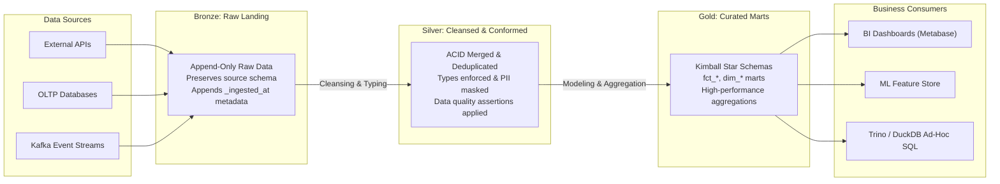

# MOD-06 - Medallion Architecture

## Status
- [ ] Not Started
- [ ] In Progress
- [ ] Completed

## Objective
Structure data lakehouse and warehouse storage layers following the standardized Medallion Architecture pattern (Bronze -> Silver -> Gold).

## Concepts
- **The Medallion Architecture Paradigm**: Multi-layered data hygiene and refinement framework establishing clear quality and governance boundaries.
- **The Bronze Layer (Raw / Ingestion)**:
  - Raw, unvalidated append-only data directly from sources (JSON, CSV, CDC logs).
  - Preserves original source schema with appended ingestion metadata columns (`_ingested_at`, `_source_file`).
- **The Silver Layer (Cleansed / Conformed)**:
  - Deduplicated, type-cast, schema-enforced, enriched data.
  - PII masked or encrypted; business keys validated; referential integrity checked.
- **The Gold Layer (Business Marts / Curated)**:
  - Modeled for business analytics using Kimball Star Schemas or denormalized reporting views.
  - High performance, indexed, aggregation-ready.

## Learning Resource
- **Title**: Fundamentals of Data Engineering (Chapter 4 & 5: Storage and Transformation)
- **Provider / Author**: Joe Reis & Matt Housley (O'Reilly)
- **URL**: https://www.oreilly.com/library/view/fundamentals-of-data/9781098108298/
- **Type**: Textbook
- **Topic**: Medallion Architecture, Lakehouse Tiers
- **Difficulty**: Intermediate
- **Category**: 🔥 ESSENTIAL

## Practice
- [ ] Review the Medallion architecture diagram below.
- [ ] Map an upstream REST API response through all three tiers:
  - Bronze: Ingest raw JSON payload appending `_ingested_at`.
  - Silver: Parse JSON fields, cast timestamps, filter out test accounts, deduplicate on `id`.
  - Gold: Build a daily revenue mart aggregating sales by customer cohort.

## Completion Criteria
- [ ] Articulate the exact responsibilities and data hygiene rules of Bronze, Silver, and Gold tiers.
- [ ] Enforce schema validation and PII masking strictly at the Silver transition boundary.
- [ ] Build dimensional marts exclusively in the Gold tier.

## Software / Tools

### Required Software
| Tool | Purpose | macOS Compatible | Free | Installation Method | Official Resource |
| :--- | :--- | :--- | :--- | :--- | :--- |
| PostgreSQL 16 (via Docker) | Relational database testing | Yes (Docker) | Yes | `docker run -d -p 5432:5432 postgres:16` | https://www.postgresql.org/ |

### Optional Software
| Tool | Purpose | macOS Compatible | Free | Purpose / Note |
| :--- | :--- | :--- | :--- | :--- |
| DBeaver Community | SQL query exploration | Yes | Yes | Universal free database GUI |

## Notes
### Medallion Lakehouse Architecture

## Related Lessons
- Prerequisites: [[MOD-02 - Kimball Dimensional Modeling]]
- Next Lesson: [[MOD-07 - Data Vault 2 Basics]]
- Phase Overview: [[Phase 2 - Storage & ELT]]
