# DBT-01 - Modern ELT Architecture

## Status
- [ ] Not Started
- [ ] In Progress
- [ ] Completed

## Objective
Understand the architectural paradigm shift from legacy ETL to modern cloud warehouse ELT and in-place transformations.

## Concepts
- **Legacy ETL Bottlenecks**: Extract -> Transform on separate compute server (Informatica, Talend) -> Load. Created compute bottlenecks, proprietary transformation code, and tight coupling.
- **Modern ELT Architecture**: Extract -> Load raw data directly into scalable cloud/columnar storage -> Transform in place using SQL.
- **Compute & Storage Decoupling**: Leveraging the near-infinite parallel processing power of modern warehouse engines (Snowflake, BigQuery, DuckDB) rather than external transformation clusters.
- **dbt-core as Transformation Orchestrator**: Version control, automated testing, documentation, and DAG compilation for in-warehouse SQL transformations.

## Learning Resource
- **Title**: Fundamentals of Data Engineering (Chapter 7: Transformation)
- **Provider / Author**: Joe Reis & Matt Housley (O'Reilly)
- **URL**: https://www.oreilly.com/library/view/fundamentals-of-data/9781098108298/
- **Type**: Textbook
- **Topic**: ETL vs ELT, Modern Data Stack
- **Difficulty**: Intermediate
- **Category**: 🔥 ESSENTIAL

## Practice
- [ ] Review the ETL vs ELT architecture diagram below.
- [ ] Contrast how schema migrations and data corrections are handled in ETL (re-run entire pipeline) vs ELT (re-transform from raw data in place).

## Completion Criteria
- [ ] Articulate the technical advantages of ELT over legacy ETL.
- [ ] Explain how ELT preserves raw data fidelity for historical replay and schema drift recovery.
- [ ] Describe the role of dbt in modern ELT pipelines.

## Software / Tools

### Required Software
| Tool | Purpose | macOS Compatible | Free | Installation Method | Official Resource |
| :--- | :--- | :--- | :--- | :--- | :--- |
| PostgreSQL 16 (via Docker) | Relational database testing | Yes (Docker) | Yes | `docker run -d -p 5432:5432 postgres:16` | https://www.postgresql.org/ |

### Optional Software
| Tool | Purpose | macOS Compatible | Free | Purpose / Note |
| :--- | :--- | :--- | :--- | :--- |
| DBeaver Community | SQL query exploration | Yes | Yes | Universal free database GUI |

## Notes
### ETL vs ELT Architecture

```mermaid
flowchart TD
    subgraph LegacyETL["Legacy ETL Architecture"]
        direction LR
        S1["Sources"] --> E1["Extract"]
        E1 --> T1["Transform Server<br/>(External ETL Cluster)"]
        T1 --> L1["Load Cleaned Data"]
        L1 --> D1["Data Warehouse"]
    end

    subgraph ModernELT["Modern ELT Architecture"]
        direction LR
        S2["Sources"] --> E2["Extract & Load<br/>(Fivetran / Airbyte / Custom)"]
        E2 --> R2["Raw Storage Layer<br/>(Bronze / S3 / DuckDB)"]
        R2 --> T2["Transform In-Place<br/>(dbt-core SQL Engine)"]
        T2 --> M2["Dimensional Marts<br/>(Gold Analytics)"]
    end
```

## Related Lessons
- Prerequisites: [[MOD-06 - Medallion Architecture]]
- Next Lesson: [[DBT-02 - Embedded Analytics with DuckDB]]
- Phase Overview: [[Phase 2 - Storage & ELT]]
