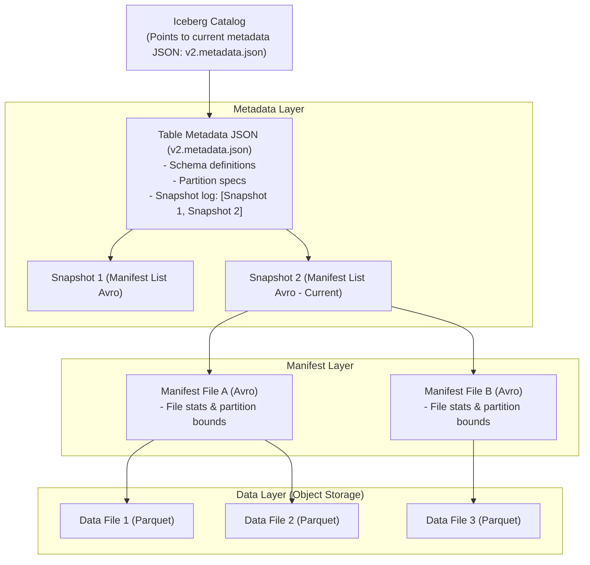

# LAK-05 - Apache Iceberg Architecture

## Status
- [ ] Not Started
- [ ] In Progress
- [ ] Completed

## Objective
Master Apache Iceberg's metadata hierarchy: Catalog, Table Metadata JSON, Manifest Lists, Manifest Files, and Data Files.

## Concepts
- **The Iceberg Metadata Hierarchy**:
  1. **Iceberg Catalog**: Stores the current metadata pointer (e.g. `v3.metadata.json`).
  2. **Table Metadata JSON**: Tracks table schema, partition spec, snapshot log, and current snapshot ID.
  3. **Manifest List (Avro)**: One file per snapshot; lists all manifest files that compose the snapshot with partition summary bounds.
  4. **Manifest File (Avro)**: Lists individual Parquet data files, record counts, file paths, and lower/upper column bounds.
  5. **Data Files (Parquet)**: Actual raw columnar data files.
- **Atomic Commits**: Creating new snapshots by writing new manifest files and atomically swapping the catalog pointer via CAS (Compare-And-Swap).
- **Zero S3 List Calls**: Query engines plan queries by reading manifest Avro files, completely eliminating S3 `LIST` overhead.

## Learning Resource
- **Title**: Apache Iceberg: The Definitive Guide (Chapter 3: Iceberg Architecture)
- **Provider / Author**: Tomer Shiran, Jason Hughes, Alex Merced
- **URL**: https://www.dremio.com/resources/guides/apache-iceberg-the-definitive-guide/
- **Type**: Free Official eBook
- **Topic**: Iceberg Metadata Tree, Manifests, Snapshots
- **Difficulty**: Advanced
- **Category**: 🔥 ESSENTIAL

## Practice
- [ ] Review the Iceberg metadata hierarchy Mermaid diagram below.
- [ ] Walk through how an atomic commit appends a new snapshot without rewriting existing data files.
- [ ] Explain how column lower/upper bounds in manifest files prune data files before reading Parquet footers.

## Completion Criteria
- [ ] Recite the 5 layers of the Iceberg metadata tree in exact order.
- [ ] Explain how Iceberg performs atomic commits on object storage without distributed locks.
- [ ] Articulate how manifest pruning accelerates query planning.

## Software / Tools

### Required Software
| Tool | Purpose | macOS Compatible | Free | Installation Method | Official Resource |
| :--- | :--- | :--- | :--- | :--- | :--- |
| Docker / MinIO | Local object storage & service container | Yes | Yes | `brew install --cask docker` | https://min.io/ |

### Optional Software
| Tool | Purpose | macOS Compatible | Free | Purpose / Note |
| :--- | :--- | :--- | :--- | :--- |
| DuckDB CLI | Direct Parquet/Iceberg querying | Yes | Yes | `brew install duckdb` |

## Notes
### Apache Iceberg Metadata Hierarchy

## Related Lessons
- Prerequisites: [[LAK-04 - Open Table Format Paradigm]]
- Next Lesson: [[LAK-06 - Iceberg Hidden Partitioning]]
- Phase Overview: [[Phase 3 - Scale & Streaming]]
