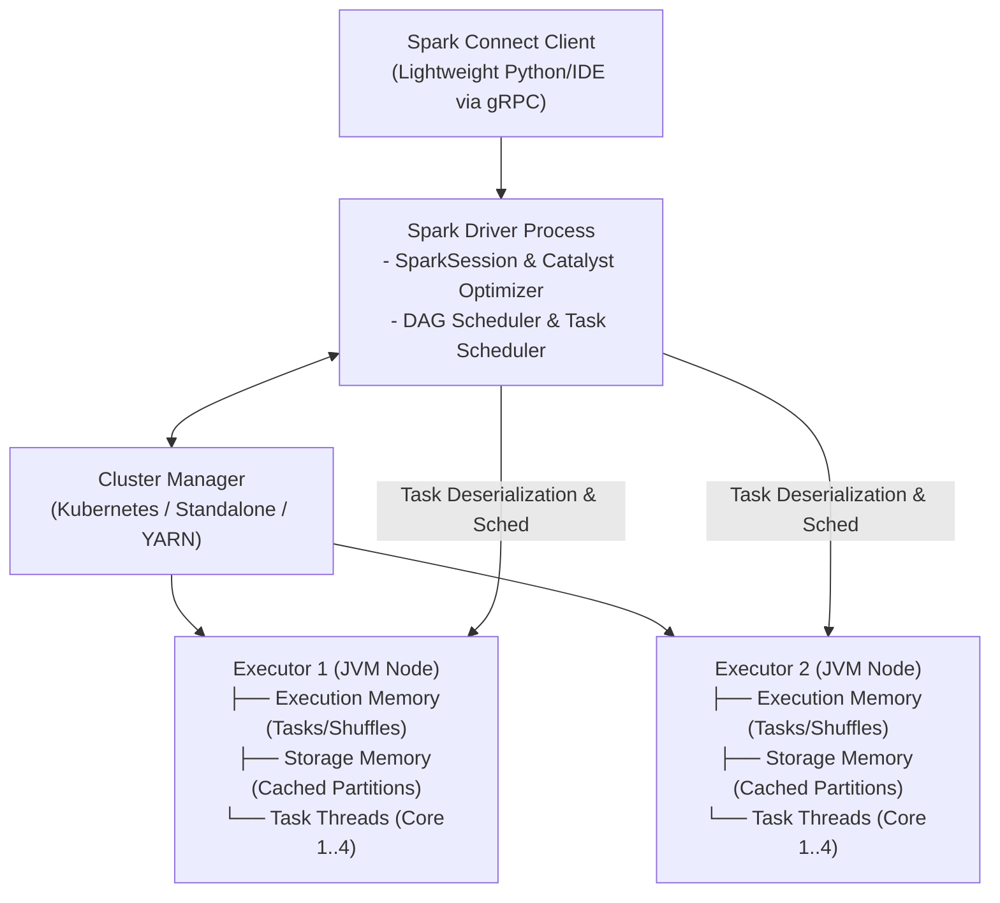

# SPK-01 - Spark 4 Cluster Architecture

## Status
- [ ] Not Started
- [ ] In Progress
- [ ] Completed

## Objective
Understand Apache Spark 4.0 cluster architecture: Driver, Cluster Manager, Executors, and Spark Connect decoupling.

## Concepts
- **Spark Cluster Components**:
  - **Driver Program**: Runs user `main()`, creates `SparkSession`, translates user code into execution DAGs, schedules tasks.
  - **Cluster Manager**: Allocates physical resources across cluster (Kubernetes, YARN, or Standalone).
  - **Executors**: JVM worker processes executing tasks and storing cached partitions in RAM/disk.
- **Spark Connect (Default in Spark 4.0)**: Decouples the client (Python, Go, IDE) from the Spark Driver using gRPC and Arrow. Enables lightweight interactive development without local JVM bloat.
- **Jobs, Stages, and Tasks**:
  - *Job*: Triggered by an action (`count()`, `collect()`, `write()`).
  - *Stage*: Boundary determined by wide transformations requiring shuffles (`groupBy()`, `join()`).
  - *Task*: Smallest unit of execution; processes a single data partition inside an executor thread.

## Learning Resource
- **Title**: Learning Spark (2nd Edition) - Chapter 1 & 2: Introduction and Architecture
- **Provider / Author**: Jules S. Damji et al. (O'Reilly)
- **URL**: https://www.oreilly.com/library/view/learning-spark-2nd/9781492050032/
- **Type**: Textbook
- **Topic**: Spark Cluster Architecture, Jobs, Stages, Tasks
- **Difficulty**: Advanced
- **Category**: 🔥 ESSENTIAL

## Practice
- [ ] Review the Spark 4 cluster architecture diagram below.
- [ ] Initialize a local PySpark session in Python using `SparkSession.builder.master("local[*]")`.
- [ ] Access the Spark UI at `http://localhost:4040` and inspect active executors and memory allocations.

## Completion Criteria
- [ ] Explain the relationship between Jobs, Stages, and Tasks in Spark execution.
- [ ] Describe how Spark Connect separates client code execution from Driver DAG compilation.
- [ ] Navigate the Spark UI (`localhost:4040`) to identify stage execution timelines.

## Software / Tools

### Required Software
| Tool | Purpose | macOS Compatible | Free | Installation Method | Official Resource |
| :--- | :--- | :--- | :--- | :--- | :--- |
| PySpark 4.0 | Distributed processing | Yes | Yes | `uv pip install pyspark==4.0.0` | https://spark.apache.org/ |

### Optional Software
| Tool | Purpose | macOS Compatible | Free | Purpose / Note |
| :--- | :--- | :--- | :--- | :--- |
| OpenJDK 17 | Java runtime for local PySpark | Yes | Yes | Install via `brew install openjdk@17` |

## Notes
### Apache Spark 4.0 Cluster Architecture

## Related Lessons
- Prerequisites: [[LAK-08 - Open Table Catalogs]]
- Next Lesson: [[SPK-02 - Spark Connect Architecture]]
- Phase Overview: [[Phase 3 - Scale & Streaming]]
