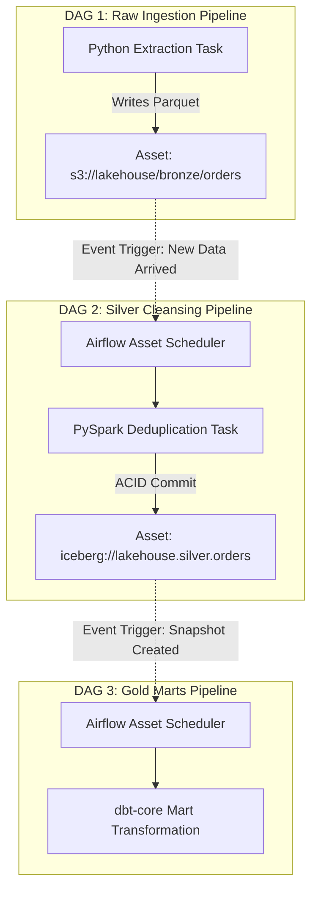

# AIR-04 - Data-Aware Asset Scheduling

## Status
- [ ] Not Started
- [ ] In Progress
- [ ] Completed

## Objective
Transition from rigid time-based cron scheduling to modern event-driven asset dependencies using Airflow 3.x `@asset` scheduling.

## Concepts
- **The Paradigm Shift**: In Airflow 3.x, datasets are treated as first-class **Assets** (URIs, e.g. `s3://bucket/table`).
- **Asset Inlets & Outlets**:
  - A producer task produces an asset: `outlets=[Asset("s3://bucket/orders")]`.
  - A consumer DAG schedules on asset updates: `schedule=[Asset("s3://bucket/orders")]`.
- **Eliminating Time-Based Couplings**: Downstream transformation DAGs execute the instant upstream ingestion writes new data, completely eliminating arbitrary `sleep` buffers or guessing cron schedules.

## Learning Resource
- **Title**: Apache Airflow Documentation - Data-Aware Scheduling
- **Provider / Author**: Apache Software Foundation
- **URL**: https://airflow.apache.org/docs/apache-airflow/stable/authoring-and-scheduling/datasets.html
- **Type**: Official Documentation
- **Topic**: Asset Scheduling, Data-Aware DAGs, Event-Driven
- **Difficulty**: Advanced
- **Category**: 🔥 ESSENTIAL

## Practice
- [ ] Review the Airflow 3.x asset-driven scheduling diagram below.
- [ ] Define two separate DAGs:
  - Producer DAG: Extracts daily transactional files and marks `Asset("s3://lake/bronze_orders")` as updated.
  - Consumer DAG: Scheduled on `schedule=[Asset("s3://lake/bronze_orders")]`, automatically triggering dbt-core model transformations.

## Completion Criteria
- [ ] Configure asset producer and consumer tasks using Airflow Asset URIs.
- [ ] Demonstrate automatic downstream DAG triggering upon upstream asset update.
- [ ] Articulate why data-aware asset scheduling is superior to arbitrary time-based cron intervals.

## Software / Tools

### Required Software
| Tool | Purpose | macOS Compatible | Free | Installation Method | Official Resource |
| :--- | :--- | :--- | :--- | :--- | :--- |
| Apache Airflow 3.x | Asset scheduling | Yes | Yes | `Docker Airflow` | https://airflow.apache.org/ |

### Optional Software
| Tool | Purpose | macOS Compatible | Free | Purpose / Note |
| :--- | :--- | :--- | :--- | :--- |
| kcat (formerly kafkacat) | Kafka CLI producer/consumer probe | Yes | Yes | `brew install kcat` |

## Notes
### Airflow 3.x Asset-Driven Scheduling

## Related Lessons
- Prerequisites: [[AIR-03 - TaskFlow API and Dynamic DAGs]]
- Next Lesson: [[AIR-05 - Event-Driven Orchestration]]
- Phase Overview: [[Phase 3 - Scale & Streaming]]
