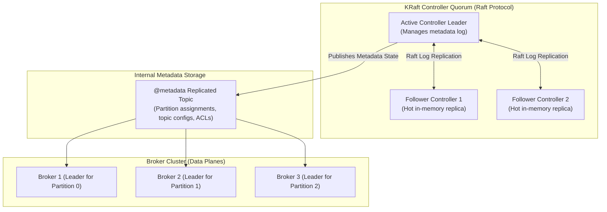

# KFK-02 - Kafka 4 KRaft Consensus

## Status
- [ ] Not Started
- [ ] In Progress
- [ ] Completed

## Objective
Deploy and configure an Apache Kafka 4.0 cluster running in pure KRaft mode with zero ZooKeeper dependencies.

## Concepts
- **ZooKeeper Removal in Kafka 4.0**: Apache Kafka 4.0 completely deprecated and removed ZooKeeper.
- **KRaft (Kafka Raft Metadata Mode)**: Metadata is managed internally within Kafka as a replicated event topic (`@metadata`).
- **Quorum Controllers**: A dedicated quorum of controller nodes running the Raft consensus algorithm elects an Active Controller leader.
- **Sub-Second Failover**: Followers maintain warm, in-memory state machines replicating the metadata log, enabling instantaneous failover when a leader crashes.

## Learning Resource
- **Title**: Kafka: The Definitive Guide (2nd Edition) - KRaft Mode
- **Provider / Author**: Gwen Shapira et al. (Confluent)
- **URL**: https://www.confluent.io/resources/kafka-the-definitive-guide-2nd-edition/
- **Type**: Free Official eBook
- **Topic**: KRaft Consensus, ZooKeeper-less Kafka
- **Difficulty**: Advanced
- **Category**: 🔥 ESSENTIAL

## Practice
- [ ] Review the Kafka 4.0 KRaft consensus diagram below.
- [ ] Deploy an Apache Kafka 4.0 cluster in pure KRaft mode via Docker Compose (provided in notes).
- [ ] Create a topic `orders` and verify cluster health using `kafka-metadata-shell.sh`.

## Completion Criteria
- [ ] Deploy a working Kafka 4.0 cluster without ZooKeeper containers.
- [ ] Explain the Raft consensus mechanism used by KRaft controller nodes.
- [ ] Create a topic with 3 partitions and replication factor of 1.

## Software / Tools

### Required Software
| Tool | Purpose | macOS Compatible | Free | Installation Method | Official Resource |
| :--- | :--- | :--- | :--- | :--- | :--- |
| Docker & Apache Kafka 4.0 (KRaft) | Event streaming broker | Yes (Docker) | Yes | `Docker compose with apache/kafka:latest` | https://kafka.apache.org/ |

### Optional Software
| Tool | Purpose | macOS Compatible | Free | Purpose / Note |
| :--- | :--- | :--- | :--- | :--- |
| kcat (formerly kafkacat) | Kafka CLI producer/consumer probe | Yes | Yes | `brew install kcat` |

## Notes
### Apache Kafka 4.0 KRaft Consensus


### Docker Compose for Kafka 4.0 KRaft
```yaml
version: '3.8'
services:
  kafka:
    image: apache/kafka:latest
    container_name: de-kafka
    ports:
      - "9092:9092"
    environment:
      KAFKA_NODE_ID: 1
      KAFKA_PROCESS_ROLES: broker,controller
      KAFKA_LISTENERS: PLAINTEXT://:9092,CONTROLLER://:9093
      KAFKA_ADVERTISED_LISTENERS: PLAINTEXT://localhost:9092
      KAFKA_CONTROLLER_LISTENER_NAMES: CONTROLLER
      KAFKA_CONTROLLER_QUORUM_VOTERS: 1@localhost:9093
      KAFKA_LOG_DIRS: /tmp/kraft-combined-logs
```

## Related Lessons
- Prerequisites: [[KFK-01 - Event-Driven Fundamentals]]
- Next Lesson: [[KFK-03 - Broker Internals and Log Partitions]]
- Phase Overview: [[Phase 3 - Scale & Streaming]]
