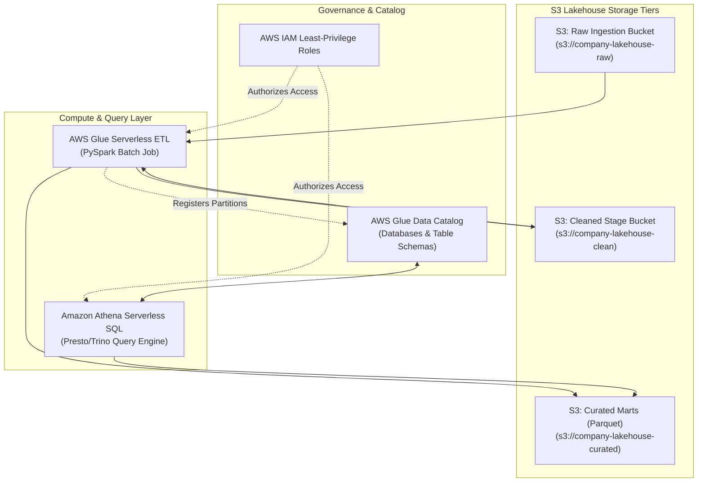

# CLD-01 - AWS IAM Security

## Status
- [ ] Not Started
- [ ] In Progress
- [ ] Completed

## Objective
Enforce the principle of least privilege using AWS Identity & Access Management (IAM) policies, roles, and service trust boundaries.

## Concepts
- **IAM Architecture**: Users, Groups, Roles (assumed by services/identities via STS), and Policies (JSON access definitions).
- **The Least Privilege Principle**: Granting only the exact API actions (`s3:GetObject`, `glue:GetTable`) on specific Resource ARNs required for pipeline execution. Never use `Action: "*"` or `Resource: "*"` in production.
- **Service Roles**: Granting AWS services (Glue, Lambda, EMR) permission to interact with S3 and KMS via Trust Policies.
- **LocalStack Emulation**: Practicing full IAM role creation, policy attachment, and credential validation 100% locally with zero cloud charges.

## Learning Resource
- **Title**: AWS IAM User Guide & Best Practices
- **Provider / Author**: Amazon Web Services
- **URL**: https://docs.aws.amazon.com/IAM/latest/UserGuide/best-practices.html
- **Type**: Official Documentation
- **Topic**: AWS IAM, Least Privilege, Cloud Security
- **Difficulty**: Intermediate
- **Category**: 🔥 ESSENTIAL

## Practice
- [ ] Review the AWS Cloud Data Architecture diagram below.
- [ ] Launch LocalStack container: `docker run -d --name localstack -p 4566:4566 localstack/localstack`.
- [ ] Write a least-privilege IAM policy `glue_s3_read_policy.json` allowing `s3:GetObject` only on `arn:aws:s3:::analytics-raw/*`.
- [ ] Create an IAM role via AWS CLI pointing to LocalStack (`--endpoint-url=http://localhost:4566`) and attach the policy.

## Completion Criteria
- [ ] Write a valid JSON IAM policy enforcing resource and action restrictions.
- [ ] Attach an IAM service role to an AWS Glue execution context.
- [ ] Verify that unauthorized API calls are denied with `AccessDenied`.

## Software / Tools

### Required Software
| Tool | Purpose | macOS Compatible | Free | Installation Method | Official Resource |
| :--- | :--- | :--- | :--- | :--- | :--- |
| AWS CLI & LocalStack | Local IAM testing | Yes | Yes | `brew install awscli && docker run localstack/localstack` | https://localstack.cloud/ |

### Optional Software
| Tool | Purpose | macOS Compatible | Free | Purpose / Note |
| :--- | :--- | :--- | :--- | :--- |
| LocalStack | Local AWS emulation | Yes | Yes | `docker run localstack/localstack` |

## Notes
### AWS Cloud Data Architecture (IaC Provisioned)


### Least Privilege Policy Example
```json
{
  "Version": "2012-10-17",
  "Statement": [
    {
      "Sid": "AllowS3RawRead",
      "Effect": "Allow",
      "Action": ["s3:GetObject", "s3:ListBucket"],
      "Resource": [
        "arn:aws:s3:::company-lakehouse-raw",
        "arn:aws:s3:::company-lakehouse-raw/*"
      ]
    }
  ]
}
```

## Related Lessons
- Prerequisites: [[KFK-09 - Stream Processing Patterns]]
- Next Lesson: [[CLD-02 - Amazon S3 Storage Architecture]]
- Phase Overview: [[Phase 4 - Cloud & DevOps]]
