# 🏛️ PRJ-01 Architecture: Local Modern ELT Pipeline

```mermaid
flowchart LR
    subgraph Sources["Source Layer (OLTP)"]
        PG["PostgreSQL 16 (Docker)<br/>orders, line_items, customers"]
    end

    subgraph Ingestion["Ingestion & Landing"]
        EXT["Python Extractor (Delta Logic)<br/>Polars / PyArrow"]
        LND["DuckDB Landing Storage<br/>(local parquet/raw tables)"]
    end

    subgraph Transformation["Transformation Layer (dbt-core)"]
        STG["Staging Views<br/>stg_orders, stg_customers"]
        INT["Intermediate Models<br/>int_customer_orders_joined"]
        MRT["Dimensional Marts<br/>fct_orders, dim_customers_scd2"]
    end

    subgraph Serving["Serving & BI Tier"]
        MB["Metabase BI Dashboard<br/>Revenue & Cohort Retention"]
    end

    PG --> EXT
    EXT --> LND
    LND --> STG
    STG --> INT
    INT --> MRT
    MRT --> MB
```

## Architectural Design Trade-Offs
- **DuckDB over Traditional Cloud DW**: Eliminates cloud egress and compute costs during development while providing native vectorized SQL execution over Parquet files.
- **dbt In-Place Transformation**: ELT avoids intermediate Python data munging, leveraging SQL query engine optimization for transformations.
- **SCD Type 2 in dbt**: Preserves customer historical addresses using dbt snapshots (`dbt snapshot`) with `check` or `timestamp` strategies.
