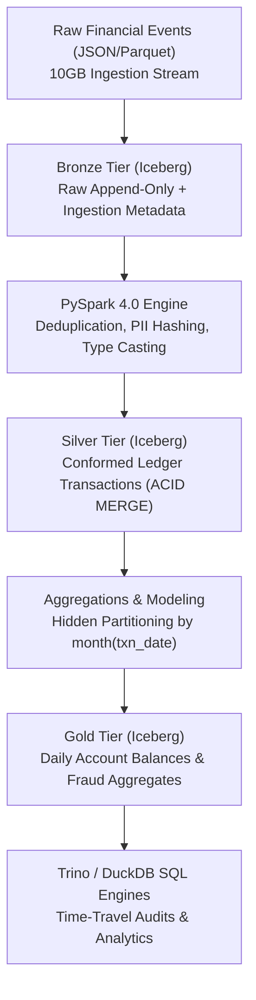

# 🏛️ PRJ-02 Architecture: Scalable Financial Lakehouse

## Core Lakehouse Principles Demonstrated
- **ACID Transactions on Object Storage**: Apache Iceberg guarantees snapshot isolation on MinIO S3 API without locking or inconsistent reads.
- **Hidden Partitioning**: Partitioned by `month(transaction_date)` and bucketed by `account_id` without requiring consumer queries to know partition physical layout.
- **In-Place Schema Evolution**: Adding metadata fields without rewriting data files.
