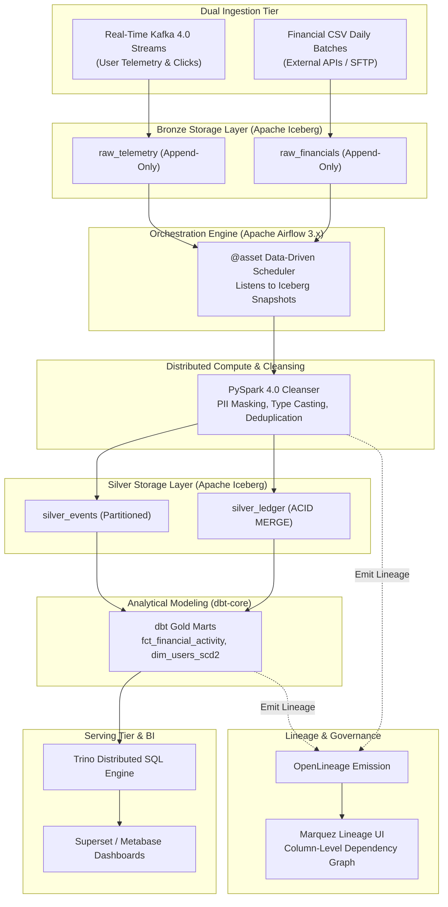

# 🏛️ PRJ-05 Architecture: Converged Enterprise Lakehouse

## Architectural Decisions & Trade-Offs (ADRs)
1. **Convergence of Batch and Streaming**: Apache Iceberg serves as the single unified storage layer for both streaming Kafka append jobs and daily batch files, eliminating lambda architecture storage duplication.
2. **Airflow 3.x Asset-Centric Dependencies**: Instead of fragile cron intervals, tasks execute automatically as soon as upstream Iceberg snapshot metadata indicates new partition writes.
3. **OpenLineage Integration**: Both PySpark and dbt-core emit OpenLineage events, capturing end-to-end column-level transformations into Marquez without manual documentation.
