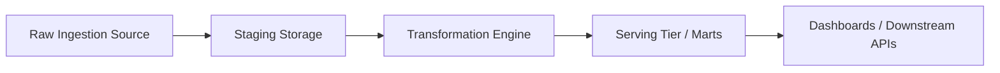

# PRJ-XX: Project Name

## Project Overview
[Comprehensive description of business context, engineering problem, and technical requirements.]

## Architecture


## Input, Processing & Storage Architecture
- **Input Data**: Ingestion format, schema definitions, arrival rate, volume.
- **Processing Engine**: Compute runtime, transformations, batch/streaming boundaries.
- **Storage Tier**: Storage formats, partitioning strategy, ACID guarantees.
- **Serving / Output**: Query engine, BI connectors, downstream schemas.

## Milestones & Tasks
- [ ] Milestone 1: Environment orchestration and infrastructure provisioning.
- [ ] Milestone 2: Source ingestion and raw landing tier.
- [ ] Milestone 3: Transformation, business logic, and data hygiene.
- [ ] Milestone 4: Quality assertions, lineage tracking, and schema tests.
- [ ] Milestone 5: End-to-end integration testing and verification.
- [ ] Milestone 6: Architectural defense documentation and repository polish.

## Verification Checklist
- [ ] Environment spins up cleanly via single command (`docker compose up -d`).
- [ ] Pipeline executes idempotently without duplicate record insertion.
- [ ] All automated data quality tests pass with zero failures.
- [ ] Code conforms to strict typing (`mypy --strict`) and linting (`ruff`).
- [ ] Comprehensive documentation and architecture diagrams verified.

## Lessons Learned & Production Reflections
- Architectural tradeoffs evaluated.
- Performance bottlenecks identified and resolved.
- Cost and operational considerations.

## Repository Structure & Specification
```text
project-root/
├── .github/workflows/
├── src/
├── tests/
├── docker-compose.yml
├── pyproject.toml
└── README.md
```
